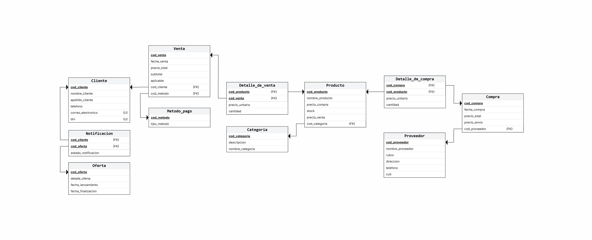

# Base de Datos - Tienda de Artículos Deportivos

[]()
[]()
[]()

## 1. Presentación y contexto

Este proyecto fue desarrollado en la asignatura **Bases de Datos 1**.
El trabajo consiste en el diseño e implementación de una base de datos relacional destinada a la gestión de una tienda de artículos deportivos.
La propuesta busca representar las principales operaciones del negocio, contemplando la administración de productos, categorías, clientes, proveedores, compras, ventas y ofertas, entre otros elementos necesarios para organizar y consultar la información.
El desarrollo se llevó a cabo de manera progresiva, siguiendo distintas etapas de análisis, diseño, implementación, validación y optimización.

## 2. Alcance del proyecto

La base de datos permite organizar y gestionar información relacionada con las siguientes áreas del negocio:

- **Productos y categorías:** registro de artículos deportivos, sus precios, existencias y clasificación.
- **Clientes:** almacenamiento de información personal y datos de contacto.
- **Proveedores:** registro de proveedores y sus datos identificatorios.
- **Compras:** almacenamiento de compras realizadas a proveedores y sus respectivos detalles.
- **Ventas:** registro de operaciones comerciales, clientes asociados, métodos de pago y productos vendidos.
- **Ofertas y notificaciones:** administración de ofertas y registro de su asociación con clientes, incluyendo el estado de las notificaciones.

El modelo contempla restricciones de integridad y relaciones entre las entidades para mantener la consistencia de la información.

## 3. Objetivos generales

- Diseñar una base de datos relacional que represente las necesidades de información de una tienda de artículos deportivos.
- Identificar las entidades, atributos, relaciones y restricciones necesarias para modelar el negocio.
- Implementar el modelo mediante SQL Server, aplicando claves primarias, claves foráneas y restricciones de integridad.
- Incorporar datos de prueba que permitan validar el funcionamiento de la estructura implementada.
- Desarrollar consultas SQL que permitan obtener información relevante para el análisis y seguimiento de las operaciones comerciales.
- Explorar técnicas de optimización de consultas mediante índices y otros mecanismos proporcionados por el motor de base de datos.

## 4. Tecnologías y herramientas utilizadas

| Tecnología | Utilización |
|---|---|
| Microsoft SQL Server | Motor de base de datos relacional |
| SQL Server Management Studio | Administración y ejecución de scripts SQL |
| ERDPlus | Diseño y representación del modelo entidad-relación |
| Git | Control de versiones |
| GitHub | Alojamiento y colaboración sobre el repositorio |

## 5. Modelo de datos

El diseño de la base de datos se construyó a partir de un modelo entidad-relación, que posteriormente fue implementado en SQL Server.

### Diagrama entidad-relación



El diagrama permiten visualizar las entidades que componen el sistema, sus atributos, las relaciones entre ellas y las restricciones del modelo.
Para conocer en detalle las decisiones adoptadas durante el diseño, consultar la documentación de la [Etapa 02](docs/etapa-02/).

## 6. Documentación de avances por etapas

El desarrollo del proyecto se organizó en cinco etapas, cada una orientada a un aspecto específico del proceso de diseño e implementación.

### Etapa 01 - Análisis y relevamiento

Se definió el contexto del negocio, el alcance inicial del sistema y las reglas de negocio que sirvieron como punto de partida para el diseño de la base de datos.
[Ver documentación de la Etapa 01](docs/etapa-01/)

### Etapa 02 - Diseño de la base de datos

Se desarrolló el modelo conceptual y relacional, identificando las entidades, sus atributos, las relaciones y las restricciones necesarias. También se documentaron las principales decisiones de diseño. [Ver documentación de la Etapa 02](docs/etapa-02/)

### Etapa 03 - Implementación y validación

Se implementó la estructura de la base de datos mediante scripts SQL y se incorporaron datos de prueba. Se realizaron pruebas para verificar las restricciones de integridad y el comportamiento esperado de las operaciones de inserción. [Ver documentación de la Etapa 03](docs/etapa-03/)

### Etapa 04 - Consultas y casos de uso

Se desarrollaron consultas SQL orientadas a representar distintas necesidades de información del negocio, utilizando operaciones de agrupamiento, combinaciones de tablas, subconsultas y funciones de ventana. [Ver documentación de la Etapa 04](docs/etapa-04/)

### Etapa 05 - Optimización y conceptos avanzados

Se exploraron mecanismos de optimización mediante índices, comparando el rendimiento de consultas bajo distintas configuraciones. También se implementaron procedimientos y funciones almacenadas, transacciones con manejo de errores, triggers de auditoría y seguridad mediante usuarios, roles y permisos. [Ver documentación de la Etapa 05](docs/etapa-05/)

## 7. Estructura del repositorio

El repositorio se encuentra organizado para separar los scripts SQL de la documentación correspondiente a cada etapa.

```text
proyecto-bd1-equipo-34/
│
├── docs/
│   ├── etapa-01/
│   ├── etapa-02/
│   ├── etapa-03/
│   ├── etapa-04/
│   └── etapa-05/
│
├── sql/
│   ├── ddl/
│   ├── dml/
│   ├── tecnico/
│   └── consultas/
│
└── README.md
```

**Descripción de los directorios:**

| Directorio | Contenido |
|---|---|
| `docs/` | Documentación teórica y técnica de las distintas etapas. |
| `docs/etapa-01/` | Análisis, alcance y reglas de negocio. |
| `docs/etapa-02/` | Diagramas y decisiones de diseño. |
| `docs/etapa-03/` | Pruebas y validaciones de la implementación. |
| `docs/etapa-04/` | Documentación de consultas y casos de uso. |
| `docs/etapa-05/` | Documentación sobre optimización y conceptos avanzados. |
| `sql/ddl/` | Scripts de definición de la estructura de la base de datos. |
| `sql/dml/` | Scripts de inserción y manipulación de datos de prueba. |
| `sql/consultas/` | Consultas SQL desarrolladas durante el proyecto. |
| `sql/tecnico/` | Aborda cuestiones técnicas más profundas del proyecto. |

## 8. Guía de instalación y ejecución

Esta sección describe los pasos necesarios para crear la base de datos y cargar los datos de prueba en un entorno local.

### 8.1. Requisitos previos

Antes de comenzar, es necesario contar con:

- Microsoft SQL Server.
- SQL Server Management Studio.
- Acceso al repositorio del proyecto.

### 8.2. Obtener el proyecto

Clonar el repositorio mediante Git:

```bash
git clone https://github.com/BbtoAlcrz/proyecto-bd1-equipo-34.git
```

Ingresar al directorio:

```bash
cd proyecto-bd1-equipo-34
```

### 8.3. Crear la base de datos

1. Abrir SQL Server Management Studio.
2. Conectarse a la instancia local de SQL Server.
3. Abrir el [script de creación de la estructura](https://github.com/BbtoAlcrz/proyecto-bd1-equipo-34/blob/main/sql/ddl/creacion_BD.sql) ubicado en `sql/ddl/`.
4. Ejecutar el script para generar la base de datos y sus respectivas tablas.

**Script:** `creacion_BD.sql` 

### 8.4. Cargar los datos de prueba

Una vez creada la estructura:

1. Abrir el script de inserción de datos ubicado en `sql/dml/`.
2. Verificar que la base de datos correspondiente esté seleccionada.
3. Ejecutar el [script para incorporar los registros de prueba](https://github.com/BbtoAlcrz/proyecto-bd1-equipo-34/blob/main/sql/dml/datos_prueba.sql).

**Script:** `datos_prueba.sql`

### 8.5. Ejecutar las consultas

Con la estructura creada y los datos cargados, es posible ejecutar las consultas disponibles en `sql/consultas/` [ver consultas disponibles](https://github.com/BbtoAlcrz/proyecto-bd1-equipo-34/tree/main/sql/consultas).
Cada archivo contiene una consulta SQL orientada a resolver una necesidad de información específica del negocio.
> **Importante:** Verificar que la instancia de SQL Server esté correctamente configurada antes de comenzar.

### 8.6. Ejecutar los scripts técnicos

Con la base creada y los datos cargados, los scripts de `sql/tecnico/` pueden ejecutarse en cualquier orden. Cada uno incluye su propia demostración y puede ejecutarse más de una vez.

| Script | Tema |
|---|---|
| `optimizacion-consultas/optimizacion-consultas.sql` | Índices y optimización de consultas |
| `procedimientos-almacenados/proc_func_almacenados.sql` | Procedimientos y funciones almacenadas |
| `transacciones/transaccion.sql` | Transacciones con `TRY...CATCH` |
| `triggers-auditoria/triggers-auditoria.sql` | Triggers de auditoría |
| `seguridad/seguridad.sql` | Usuarios, roles y permisos |

> **Nota:** `seguridad.sql` requiere que la instancia esté en modo de autenticación mixto. Algunos scripts (transacciones, seguridad y triggers) modifican los datos, por lo que las consultas de `sql/consultas/` pueden devolver resultados distintos a los documentados si se ejecutan después.

## 9. Consultas y casos de uso destacados

El proyecto incorpora distintas consultas orientadas a obtener información relevante para el análisis de las operaciones comerciales.

Algunos ejemplos son:

| Consulta | Descripción |
|---|---|
| Factura de venta | Recupera el detalle de una venta, incluyendo productos, cantidades, precios y totales. |
| Ventas por categoría | Permite analizar las ventas agrupadas según la categoría de los productos. |
| Productos nunca vendidos | Identifica los productos que no registran ventas. |
| Ranking de clientes por gasto | Ordena los clientes según el importe total de sus compras. |
| Ranking de ventas por método de pago | Permite comparar los importes registrados según el método de pago utilizado. |
| Gastos superiores al promedio | Identifica los clientes cuyo gasto total supera el promedio general. |
| Ofertas sin leer | Recupera las notificaciones que figuran como enviadas y cumplen las condiciones temporales de la consulta. |
| Gastos por proveedor | Permite analizar los importes asociados a las compras realizadas a cada proveedor. |

## 10. Integrantes del equipo

| Integrante |
|---|
| Alcaraz, Benito Eduardo |
| Avalos Alurralde, Fausto |
| Barreiro, Maximiliano | 
| Escalante Velasque, Alberto Lautaro  |
| Meza, Nahiara Ayelen |

**Carrera:** Licenciatura en Sistemas  
**Institución:** Universidad Nacional del Nordeste (UNNE)  
**Año:** 2026
