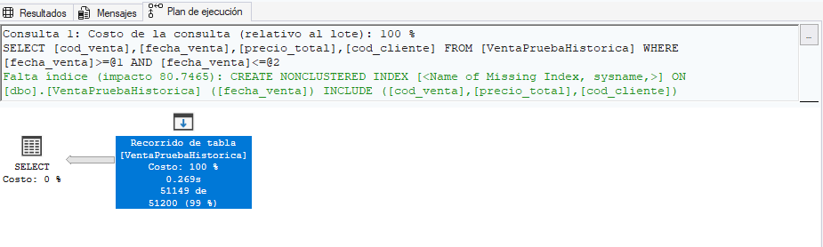
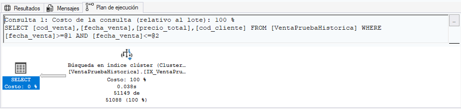
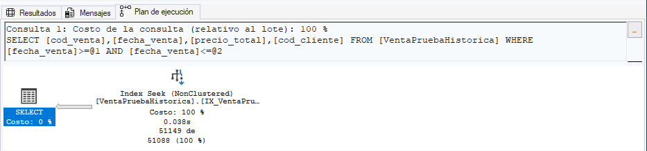

# Optimización de consultas mediante Índices

## Introducción y contexto
Se evalúa el impacto en rendimiento del SGBD al consultar un volumen de datos grande mediante búsquedas por rango de fecha sobre la tabla de ventas.
Para evaluar sin alterar la integridad ni las relaciones en el modelo principal de la tienda `Venta`, se generó una copia de la tabla solo para éstas pruebas  `VentaPruebaHistorica` y luego se automatizó la inserción de 1 millón de datos.

```SQL
CREATE TABLE VentaPruebaHistorica 
(
    cod_venta BIGINT IDENTITY(1,1),
    fecha_venta DATE NOT NULL,
    precio_total DECIMAL(10,2) NOT NULL,
    subtotal DECIMAL(10,2) NOT NULL,
    cod_cliente INT NOT NULL
);
```
Durante las pruebas de evaluación reiteraremos ésta consulta de búsqueda en un rango trimestral para evaluar el rendimiento: 
```SQL
SELECT cod_venta, fecha_venta, precio_total, cod_cliente
FROM VentaPruebaHistorica
WHERE fecha_venta BETWEEN '2024-01-01' AND '2024-03-31';
```

## Prueba 1: Consulta por rango de fechas SIN ÍNDICE (Recorrido de Tabla)

**Datos para considerar:**
Al definir una tabla sin PK ni un índice, SQL Server guarda los datos en la tabla como un "Heap" (montículo).
No significa que los registros estén desordenados aleatoriamente, sino que no existe una estructura de índice que determine su organización.

> En una Heap sin índices adicionales, probablemente se tendrá que recorrer toda la tabla para encontrar un registro, esto se conoce como **Table Scan** o **Recorrido de Tabla.**

---

Para tener disponibles en todo momento los datos del desempeño de las consultas en el SGBD, debemos **incluir el Plan de ejecución actual** desde las configuraciones de Consulta y las estadísticas de rendimiento:

```SQL
SET STATISTICS TIME ON;
SET STATISTICS IO ON;
```

Se realizó la consulta de búsqueda trimestral a la Base de Datos
Y se registró la siguiente información:
| **Medición** | **Valor** |
|:--|:--|
| Tiempo de CPU | 1157 ms |
| Tiempo total | 2330 ms |
| Lecturas Lógicas | 5209 |
| Porcentaje de Uso de la Consulta| 99% |
| Operación Principal | **Recorrido de Tabla** |



## Prueba 2: Consulta con Índice Agrupado (Clustered)

**Datos para considerar:**
Al crear un índice Agrupado, SQL Server organiza páginas de datos de la tabla según la clave del índice, permitiendo aprovechar una estructura de árbol Balanceado para localizar rápidamente los registros.

En este caso, al utilizar `fecha_venta` como clave del índice, la consulta puede realizar una búsqueda en un rango mediante un Index Seek, y evita recorrer por completo la tabla.

> Esta organización implica un costo de mantenimiento, ya que las inserciones y modificaciones deben conservar la estructura ordenada del árbol y la distribución de páginas.

---

Se crea un índice para la tabla evaluada:
```SQL
CREATE CLUSTERED INDEX IX_VentaPrueba_Fecha ON
VentaPruebaHistorica(fecha_venta); 
```
Y luego realizamos otra vez la consulta trimestral.

Se registró la siguiente información:
| **Medición** | **Valor** |
|:--|:--|
| Tiempo de CPU | 0 ms |
| Tiempo total | 728 ms |
| Lecturas Lógicas | 323 |
| Porcentaje de Uso de la Consulta| 1% |
| Operación Principal | **Búsqueda de Índice agrupado** |



## Prueba 3: Consulta con Índice No Agrupado y Cobertura
**Datos a considerar:**
Un índice Nonclustered crea una estructura independiente de la tabla original, organizada por un índice de cobertura que incorpora las columnas necesarias para completar una consulta a la tabla.

Esto permite que SQL Server obtenga tanto los registros buscados directamente con el índice, evitando accesos adicionales a las páginas de la tabla. Como resultado, se puede reducir la cantidad de lecturas lógicas necesarias para resolver la consulta.

---

Eliminamos el índice agrupado previo:
```SQL
DROP INDEX IX_VentaPrueba_Fecha ON VentaPruebaHistorica;
```

Crear un índice que cubra la consulta:

```SQL
CREATE NONCLUSTERED INDEX IX_VentaPrueba_Fecha_Cobertura
ON VentaPruebaHistorica(fecha_venta)
INCLUDE (cod_venta, precio_total, cod_cliente);
-- consideramos una consulta satisfecha si incluye al codigo de venta, código de cliente y precio total.
```
Luego realizamos otra vez la consulta trimestral, igual que antes

Se registró la siguiente información:
| **Medición** | **Valor** |
|:--|:--|
| Tiempo de CPU | 0 ms |
| Tiempo total | 727 ms |
| Lecturas Lógicas | 245 |
| Porcentaje de Uso de la Consulta| 0% |
| Operación Principal | **Index Seek (NonClustered)** |



## Resultados y Comparaciones

| Escenario | Tiempo CPU (ms) | Tiempo Total (ms) | Lecturas Lógicas | Operación Principal | 
| :--- | :--- | :--- | :--- | :--- |
 | **Sin Índice** | *1157* | *2330* | *5209* | Recorrido de Tabla | 
 | **Índice Clustered** | *0* | *728* | *323* | Búsqueda de Índice Agrupado |
  | **Índice NonClustered** | *0* | *727* | *245* | Index Seek |

## Conclusión

- **Recorrido de Tabla** obliga al motor a leer todas las páginas de datos de la tabla, lo que termina provocando una alta cantidad de lecturas lógicas y uso de CPU
- **Índice Agrupado** organiza físicamente la tabla por fecha, lo que permite ir directamente a las páginas de datos requeridas
- **Índice con Cobertura** evita el acceso a la tabla base al contener todas las columnas solicitadas en la sentencia, logrando la menor cantidad de lecturas lógicas y, en la evaluación, el menor tiempo de ejecución.
