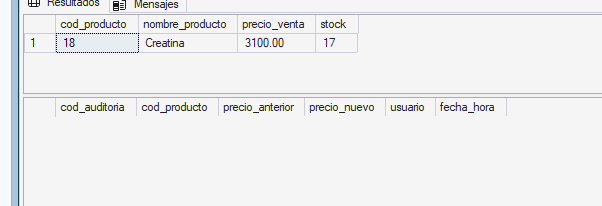
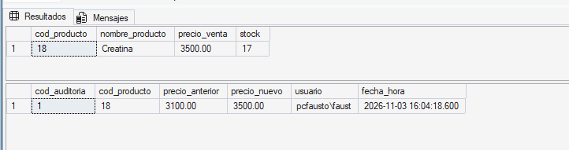
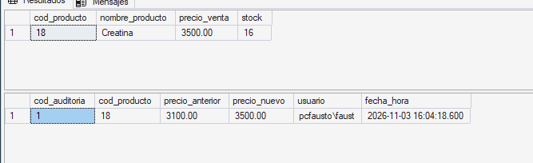

# Triggers de Auditoría en SQL Server

## 1. Definición y Objetivo
* **Triggers (disparadores):** Son procedimientos almacenados especiales que el motor ejecuta **automáticamente** cuando se hace un `INSERT`, `UPDATE` o `DELETE` sobre una tabla. No se invocan con `EXEC`.
* **Auditoría:** Es el registro histórico de los cambios en los datos: qué se modificó, quién lo hizo, cuándo y con qué valores (antes y después). Se guarda en una **tabla espejo**.
* **Objetivo:** Que el propio motor deje constancia de cada cambio, sin depender de que la aplicación se acuerde de registrarlo.

---

## 2. Ventajas y Aplicaciones
* Se ejecutan **automáticamente**, sin modificar la aplicación.
* Se disparan **siempre**, sin importar desde dónde se modifique la tabla (aplicación, SSMS o un script).
* Son **atómicos**: corren dentro de la misma transacción que la operación original, así que si ésta se deshace con `ROLLBACK`, el registro de auditoría también.
* **Aplicaciones:** historial de cambios de precios, control de productos eliminados y detección de modificaciones no autorizadas.

---

## 3. Implementación en SQL Server Express
Para crearlo se usa `CREATE TRIGGER`, se indica la tabla y el evento. `AFTER` significa que se ejecuta después de aplicar la operación:

```sql
CREATE TRIGGER nombre_trigger
ON tabla
AFTER UPDATE
AS
BEGIN
    -- lógica del trigger
END;
GO
```

Dentro del trigger el motor crea dos tablas temporales:

| Evento | `inserted` | `deleted` |
|---|---|---|
| `INSERT` | filas nuevas | vacía |
| `UPDATE` | valores **nuevos** | valores **anteriores** |
| `DELETE` | vacía | filas eliminadas |

Un trigger se dispara **una vez por sentencia**, no por fila, por eso se usan `inserted` y `deleted` como conjuntos de filas.

---

## 4. Caso aplicado al sistema de ventas
Cada vez que cambia el precio de un producto, se guarda en la tabla espejo `auditoria_producto` el precio anterior, el nuevo, el usuario y la fecha.

```sql
CREATE TABLE dbo.auditoria_producto
(
  cod_auditoria   INT IDENTITY(1,1) NOT NULL,
  cod_producto    INT NOT NULL,
  precio_anterior DECIMAL(10,2) NOT NULL,
  precio_nuevo    DECIMAL(10,2) NOT NULL,
  usuario         VARCHAR(128) NOT NULL DEFAULT SUSER_SNAME(),
  fecha_hora      DATETIME NOT NULL DEFAULT GETDATE(),
  CONSTRAINT PK_auditoria_producto PRIMARY KEY (cod_auditoria)
);
GO

CREATE TRIGGER dbo.trg_Producto_Update
ON dbo.Producto
AFTER UPDATE
AS
BEGIN
  INSERT INTO dbo.auditoria_producto (cod_producto, precio_anterior, precio_nuevo)
  SELECT i.cod_producto, d.precio_venta, i.precio_venta
  FROM inserted i
  JOIN deleted d ON d.cod_producto = i.cod_producto
  WHERE d.precio_venta <> i.precio_venta;
END;
GO
```

* `deleted` aporta el precio anterior e `inserted` el nuevo.
* `SUSER_SNAME()` y `GETDATE()` completan el usuario y la fecha automáticamente.
* La condición `WHERE` hace que solo se registren cambios de precio: si se modifica otra columna, como el `stock`, no se audita.

El mismo criterio se puede aplicar a `INSERT` y `DELETE` con triggers equivalentes. El script completo está en [`triggers-auditoria.sql`](../../../sql/tecnico/triggers-auditoria/triggers-auditoria.sql).

---

## 5. Script de demostración y resultados obtenidos
Se prueba con el producto 18 (`Creatina`, precio original $3100):

```sql
/*captura 1: estado inicial*/
SELECT cod_producto, nombre_producto, precio_venta, stock FROM Producto WHERE cod_producto = 18;
SELECT * FROM auditoria_producto;

/*captura 2: cambio de precio*/
UPDATE Producto SET precio_venta = 3500.00 WHERE cod_producto = 18;

/*captura 3: cambio solo de stock*/
UPDATE Producto SET stock = stock - 1 WHERE cod_producto = 18;
```

**Captura 1 – Estado inicial:** la Creatina a $3100 y la auditoría vacía.



**Captura 2 – Cambio de precio:** el trigger registró el precio anterior (3100), el nuevo (3500), el usuario y la fecha.



**Captura 3 – Cambio de stock:** el stock bajó a 14, pero la auditoría sigue con una sola fila porque el precio no cambió.


